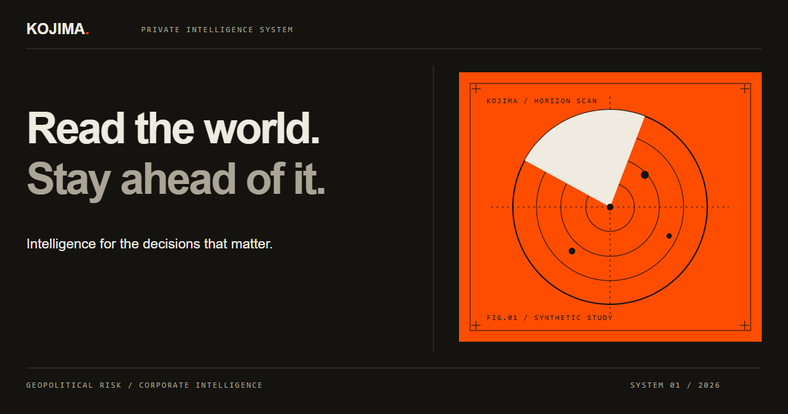

# Kojima — Intelligence System

An Astro template for corporate intelligence and geopolitical risk products. The visual system adapts [Kojima’s micro-graphic language](https://kojima-san.vercel.app/#s=932598536): warm charcoal, ivory, safety orange, instrument plates, fine rules, and monospaced metadata.



## Run locally

```sh
npm ci
npm run dev
```

Open the local URL printed by Astro (normally `http://localhost:4321`). Node 22 LTS or newer is recommended. `npm run build` generates a static site in `dist/`; `npm run preview` serves it locally. Both npm and pnpm lockfiles are maintained.

## Theme architecture

The existing Astro 5, React 19, Tailwind 4, and shadcn/ui stack is retained. Opt in at the document root:

```html
<html lang="en" data-theme="kojima" class="dark">
```

- `src/styles/global.css` retains the original base tokens and Tailwind mappings.
- `src/styles/kojima.css` scopes semantic token overrides and shadcn `data-slot` styling to `data-theme="kojima"`.
- Removing that attribute restores the base shadcn styling. Removing `.dark` selects the ivory palette.
- `src/styles/kojima-home.css` contains landing-page composition, separate from the reusable theme.
- `src/components/kojima/instrument-graphic.tsx` renders original deterministic SVG plates. No canvas, image service, or external font request is required.

Existing components continue to use their normal APIs:

```tsx
<Button variant="outline">Review briefing</Button>
<Card><CardContent>Analyst workspace</CardContent></Card>
```

Use semantic colors (`bg-background`, `text-foreground`, `border-border`) instead of hardcoded colors. Decorative orange is `--primary`; `--kojima-accent-ink` provides readable orange text on ivory. The skin supplies square component geometry, technical labels, keyboard focus, and reduced-motion rules. The normal shadcn behaviors remain intact.

The shared Slider now forwards accessible labels to its thumbs. The existing Sidebar type import was corrected for TypeScript compatibility; component APIs were retained.

## Pages and interactions

Every original page is retained: home, about, pricing, FAQ, contact, login, signup, privacy, 404, the journal, and its five posts. `/components` adds an interactive shadcn laboratory with eleven primitives.

The homepage supports radar, waveform, and matrix views; orange, paper, and dark palettes; keyboard-adjustable detail density; synthetic region filters; new deterministic studies; and SVG download. It is a marketing preview, not a live monitoring system.

Dark is the default. The theme toggle stores only `theme` in local storage and remains usable when storage is blocked. Main content and navigation are server-rendered. Responsive layouts cover mobile through wide desktop screens, with no autoplay or decorative animation.

Contact prepares a local text download. Sign-in and registration validate sample values and clear the fields. Pricing is illustrative. None of these demos authenticate users, send inquiries, collect payments, or ingest intelligence data.

## Customize

1. Update product metadata and shared navigation in `src/consts.ts`.
2. Set the production `site` URL in `astro.config.mjs`; the starter retains `https://example.com` for canonical URLs, sitemap, and RSS.
3. Change theme tokens in `src/styles/kojima.css`; keep both light and dark palettes readable.
4. Edit the landing-page copy in `intelligence-home.tsx` and `intelligence-sections.tsx`, plus the Markdown/MDX journal entries.
5. Replace demo form behavior with your backend when needed, and update the demo data-handling notice to match the deployed service.

`InstrumentGraphic` accepts `variant` (`radar`, `wave`, `grid`), `palette` (`orange`, `paper`, `dark`), numeric `seed`, `complexity` (0–100), `className`, `title`, and `decorative`. Equal inputs produce equal artwork on the server and client. SVG definition IDs are unique per component instance.

## Verification

```sh
npm run check
npm run test:e2e
```

Browser tests build and serve the production output, audit all sixteen pages in dark/light modes with axe, check widths from 320 to 1440 pixels, and exercise core interactions, downloads, and no-JavaScript content. Automated checks complement manual visual review; they do not certify accessibility.

Windows uses installed Microsoft Edge by default. Elsewhere run `npx playwright install chromium`. Set `PLAYWRIGHT_CHANNEL` to override the browser channel. Test reports and traces are ignored by Git.

## Assets and provenance

The reference site’s aesthetic and the supplied orange radar seed guided this adaptation; permission to reuse its assets was confirmed by the project owner. The included instrument renderer, favicon, and social graphic are original code-native SVG compositions. `public/og-image.png` is rendered from `public/og-image.svg`.

Local DM Sans files and unused upstream assets remain from the starter. No reference generator JavaScript was copied. Original template credit: [shadcnblocks Mainline](https://github.com/shadcnblocks/mainline-astro-template). The original MIT license is retained in `LICENSE`.

See [TODO.md](./TODO.md) for the implementation checklist and [docs/verification.md](./docs/verification.md) for validation details.
